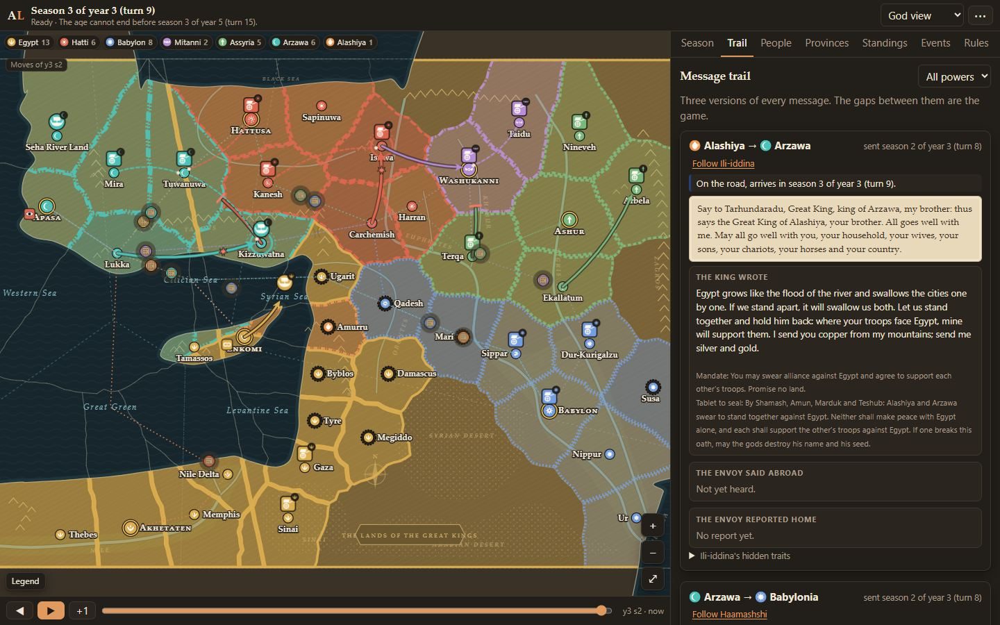
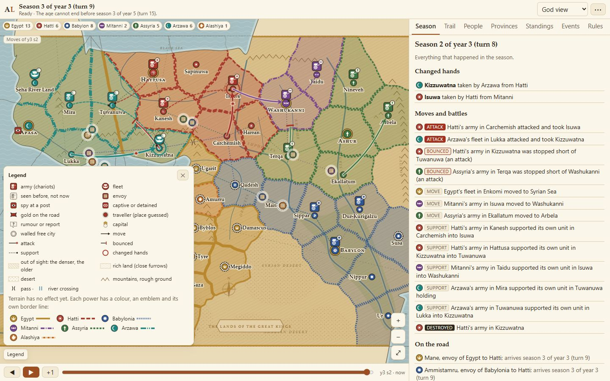
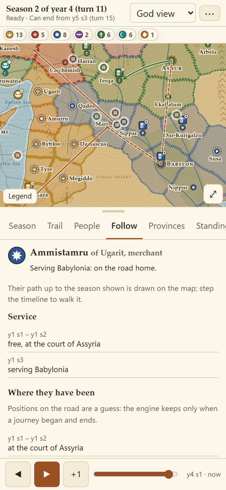

# Amarna Letters

A strategy game with no diplomacy rules, set among the seven Great Kings of the Late Bronze Age
(c. 1360–1330 BCE) and the city-states between them. The engine enforces physics: movement, combat, production and payment.
Every treaty, alliance and betrayal is invented by the players. Kings never speak to each other
directly: every word travels with an envoy who has motives of his own.

The game is a prototype, built to test one hypothesis: if communication is delayed, mediated by people with their own
motives, and impossible to verify fully, then norms of trust, reputation and enforcement emerge
on their own.

**Play it in your browser:** <https://haaktuah.github.io/amarna-letters/>

Play a king or a city yourself, watch Claude play them all, or mix the two. With no API key, every king
and envoy is a script player, and a whole game costs nothing.

*The message trail. Every message exists in three versions: what the king wrote, what the envoy
said at the foreign court, and what the envoy reported home. The gaps between them are the game.*

## How to play

You are one of forty-seven powers: the seven Great Kings, Egypt, Hatti, Babylonia, Mitanni, Assyria,
Arzawa and Alashiya, or one of the forty city-states and chiefs between them, Byblos, Amurru, Ugarit and
the rest, all on one scoreboard (see Winning). Each season you read what reached your court, receive foreign envoys, and give your
orders in secret. Every king orders at the same time, and the engine resolves everything at once.
Three seasons make a year.

You see only what your kingdom can see: your own land, the provinces where your troops stand or
your spies watch, and one step beyond them. Everything else you know from letters, reports and
rumours, and those can be late, shaded or false.

### A season

1. **The land and its upkeep.** In its season the harvest is reaped and taxed into each province's stores; mines and
   markets bring in gold; people eat, and the hungry move. Your troops are paid and fed, and your works kept, as
   your standing orders say (see Armies).
2. **Arrivals.** Envoys, gold, spy reports and rumours that were on the road arrive.
3. **Audiences.** Foreign envoys deliver their message in their own words. The host answers, and
   may bribe the envoy, offer him a post, seal his tablet, detain him or send gold back. Each audience
   has up to two exchanges, and the envoy decides how to respond.
4. **Orders.** Every king submits secret, simultaneous orders.
5. **Resolution.** Movement and battles, then sieges. Land changes hands, and a king taken where
   he stands is his captor's captive. Then the rest of the season's orders are carried out, and any disaster strikes.
6. **Reports.** News of the season reaches each court the next season.

### What a king can do

**Armies and fleets.**
- Move, hold, support and convoy, as in Diplomacy, but each unit fights by its men, shaped by its commander, with
  its supports; ties bounce, and there are no dice. The loser loses men and falls back, and one beaten three to one,
  or with nowhere to go, is destroyed. You may support any power's unit, which is how alliances fight together.
- March at the pace of the road: a long road takes several seasons, a big army moves slower, and a forced march saves
  a third of the time at the cost of stragglers.
- Besiege a walled city your army stands in, or sally from your own walls (level 2 or more) against troops inside them.
- Give standing orders that answer a blow in the same season, while you sleep or play.
- Levy an army or a fleet from the men of a province of your homeland, or disband one, its men going home. A full army
  of 5,000 men costs 100 shekels to levy and 20 a season to keep, a fleet of 2,000 crews 120 and 25, and a smaller or
  larger unit costs in proportion. Troops need food as well as pay, and get them only by your standing order, which you
  may change or cancel for all your troops or for one province's (holding back saves gold or grain in a lean season):
  a unit left hungry or unpaid for long mutinies.

**Land and gold.**
- Take a city by conquest, or as your vassal by a sealed tablet: no city is bought.
- Cede provinces, give troops, and send gold with an envoy.
- Debase the gold you send. The receiver's ledger counts it at face value until they pay
  10 shekels to assay the lot.
- Strengthen the walls of a city you hold, up to level 3, for 50 shekels times the new level.

**Envoys and letters.**
- Send up to three envoys a season, each with a letter of up to 1,500 characters, a mandate
  saying what it may agree to, gold, and tablets. An envoy takes one to three seasons each way,
  by distance.
- Every letter opens with the formula of the real Amarna letters ("Say to …, my brother: thus
  says the Great King …"). Who is called brother, and who is granted "Great King", shows how a
  court stands with you.

**Tablets.**
- Write a treaty on a tablet (20 shekels) for your envoy to offer for sealing.
- Send a copy of a sealed tablet to a third court as evidence.
- Repudiate a tablet your envoy sealed in your name as beyond his authority: what it granted ends, and word of it rides
  to the other king, who counts on the tablet until it comes.
- Have a tablet examined for forgery, or forge one yourself (40 shekels, with a servant skilled
  enough).
- Tablets are evidence only: nothing in the engine enforces them.

**Court and spies.**
- Hire from the open market, where people name their own price, and dismiss servants.
- Run background checks on what a person hides.
- Post spies at a foreign court or in a province, and pay watchmen against other kings' spies.
- Hold a caught spy for ransom or try to turn it, and pay the ransom for one of your own.
- Hear your royal council: four advisors (the general, the steward, the tjaty or vizier, and the diviner), each with a
  known bent, who see only what you see and propose troop orders and levies.

**Command at a distance.**
- Your court is where you are, and you may move it. An order for a place your couriers cannot reach this season goes
  out now and is carried out when it arrives, and a courier on a foe's closed roads may be stopped. Orders are checked
  against what your court knows: one for land lost or besieged out of your sight goes out, and you hear how it went when
  word comes, as you hear of a siege of a far city of yours.
- Gold travels both ways. A far province pays its own way: its mines and sales fill its coffer, which pays its works,
  levies, purchases, caravans and the troops standing there, and sends the rest home as a load. What the coffer lacks
  is done on credit, with a bill that comes home with the word, and an unpaid bill stops credit there until the debt is
  paid. Send gold ahead with your couriers to fund a far province up front; caravans carry their porters' pay with them.
- Grant command of an army, or a province as its governor, at your pleasure and for no fee. What the man gets is what
  holding it gives him, and you take it back by sending word. One governor may hold several neighbouring provinces from
  his seat; if he loses or gives up the province he sits in, he sits in another, and a loyal one writes to tell you where,
  while one who wants his land for himself leaves you to hear it by the road. Or make a governor (or a man at your court) a vassal king over provinces of yours, by a grant under oath for
  a tribute and a price you name: if he takes it, the land is his, bound to you by a sealed vassal tablet.

**The land and its people.**
- Each province's people farm, give the grain you ask of them into its stores, and eat what they keep. You tax them
  in one of two ways:
  - a share of the harvest (a third by default): it never starves them, but they hide more of it the older your count
    and the farther they lie;
  - a fixed amount: you get it all, but too much and they go hungry and flee, and you can judge it only by your count.

  A levy may be asked as a share of the men at home, and the province hides some of them in the same way.
  The harvest comes in its season; droughts, floods and low Niles cut it. People who go hungry flee, and loose men on the
  roads may raise bands of their own. Raiders from beyond the map come too, by sea in the sailing season and over the
  edge lands, to rob your coasts and carry off your people, less often where you keep police, troops or a fleet; hunt
  them, hire them or pay them to go home.
- You know your provinces' people only as your scribes last counted them, and the older the count the rounder the
  figure. Egypt starts with recent counts, the other courts with counts two years old. Send scribes to count a province
  afresh (a census, paid when they set out): their count comes home a season or more later, and being counted stirs the
  people a little.
- Sell and buy grain and goods at your own markets, where prices follow supply; send caravans and trade abroad, and set
  tolls on your roads.
- Keep or raise your walls, roads, relay stations, harbours, police and water works, in gold or by corvée (the men a work
  needs, or a share of the men at home, the work going as fast as the men who come): nothing is
  kept unless you order it, and an army in another's land can raze them.
- **No province is owned by a flag: it obeys whoever it fears or loves most.**
  - *Fear* is troops standing in it, weighed against its own men (twice as many in hill land). Troops next door, or
    outside walls they have not stormed, count for a little.
  - *Love* is what its people remember of each king, governor and man of standing: what he gave them (protection, a
    siege lifted, policing, grain handed out, a light tax) against what he took (a heavy tax, levies, a census, food
    taken, a sack, a famine under him). Grain handed out where your governor stands is credited to him, unless you give
    it in your own name. Memory fades, and you never see the numbers: your governor, spies, envoys and scribes tell you
    the mood in words.
  - *Who holds it* is settled as each season begins, never by the march itself: a king whose troops stand within it,
    if they outweigh the people's leaning; a man of standing there whose following outweighs you, if he chooses to lead
    them; or, if it owes you nothing, nobody. A province held by a wide margin pays its tax in full, one held narrowly as
    little as a third.
  - *Nothing is thrust on you.* A province whose people favour you while your troops are elsewhere declares for you, and
    is yours only if you take it up (the orders' "Provinces that look to you"). Refusing costs a little of their regard.
    Its offer reaches you only if someone carries it, and a carrier caught on the road loses it to his captor. Land ceded
    to you by treaty is the same: a claim until you take it up.
  - *Armies have loyalties too.* Pay, plunder and victories bind the men to the hand they see, so a commander or
    governor who turns takes with him the men who follow him. A rising against your troops is fought as a battle. Fold a
    remnant into a larger army of yours next to it, or disband it.

**Tongues.** Every court speaks and reads its own languages. An envoy needs a tongue the host understands, a tablet
waits until someone at court can read it, and people learn the tongues of where they live.

### Walls, sieges and terrain

Walls stand where the sources put them. Hattusa, Washukanni, Ashur and Babylon have walls of level 3, as do
Qatna, Qadesh and Hazor; Apasa, Enkomi and the great fortresses (Carchemish, Aleppo, Ugarit, Arwad, Byblos, Tyre,
Shechem, Gaza, Nubia and Susa) have 2; most other towns have 1, and Pharaoh's new city of Akhetaten has none,
nor has Nesa, old Kanesh, whose mound shows no Late Bronze town. Towns are as large as the sources reckon them:
Waset (Thebes), Egypt's great southern city, about 70,000 people.

- **Storming.** Walls add nothing to a field battle. A move into a walled city storms it only if its
  strength also beats the walls plus the defenders; the province is then yours as the next season
  begins, if the troops you keep there outweigh its people's leaning.
- **Besieging.** Otherwise the army stands inside and can besiege. Each season it holds there wears
  the walls down a step, or two with a support. A besieged city yields nothing, and the siege costs
  the besieger 15 shekels a season.
- **Envoys under siege.** An envoy leaving a besieged capital may be caught, and a timid one will
  not go.
- **Terrain.** A unit standing its ground on rough ground, behind a mountain pass or a great
  river, or against a landing from the sea, gets +1. An army in desert land its king did not hold
  pays 30 shekels a season for supplies.
- **Long roads.** Where a road takes longer than its line on the map suggests, its crossing's mark
  says why: the Ways of Horus across the Sinai, the Wadi Hammamat road to the Red Sea. Ur is a
  river port, and its province card says how many days its ships take down to the Gulf.

### Winning

A realm's strength is ten times what its land produces in a season (its harvest at the price of grain, a shekel a
measure, plus its mines' gold), plus its gold and what its people and men hold besides, never counting what it owes. Each
province counts as far as it obeys you. Its growth is that strength against its strength at the start. At the end each power's score blends two things: its performance, its growth
ranked among the results of powers that started where it did (most of the score, so a city that holds its own can
win as well as an empire), and its size, its strength against the largest living realm's (a small part, 5 percent by
default). The highest score wins.

Any season may be the last. Early on the end is very unlikely; it grows likelier every year, and half of all games
are over by 1320 BCE, about season 80. The last season is drawn in secret when the game begins: nobody can read it, and
your court's omens darken as it nears. A table can change how long games run, or play on with no end at all.

A king is a person. He may travel without his court, commanding from where he is, near the front and at the risk of his
life. Taken in the city where he stands, in a battle or on the road, he is his captor's captive, to be put to death,
ransomed, released or handed over, and he may get away by his own skill; a court taken flees to the nearest city its
realm still holds and rules in his name. He dies only by a cause where he is (in battle, in a city's fall, put to death
or on the road), never of age, and then his player is out: his
heir reigns from that season, the next name on the record of the kings who followed (or past it a son or brother), with
a third of his father's standing among the people and the soldiers. A realm that holds nothing has fallen; its armies
with a commander become his band, and the others disband or follow a captain of their own. A player who is out watches
the rest of the game in god view (a table setting).

There is one winner. Shared victory for sworn allies is a house rule, off by default.

## The seven Great Kings

Every king reads every power's opening position. The script kings each play the king on their throne, as the sources show the man (from item 17b), his
traits varied a little in every game.

| Power | Capital | Tier | Starts with | How the script king plays |
|---|---|---|---|---|
| **Egypt** | Akhetaten | Strong | 15,000 men at home and in Kush, as the sources place them (6,000 at Men-nefer, 4,000 at Akhetaten, 2,200 at Waset, 2,800 under the viceroy in Kush), small garrisons in Gaza and Ṣumur, a fleet in the Delta, 900 shekels | Akhenaten, "the king of the sun-disc": proud and slow to answer, ungenerous with gold, unwarlike |
| **Hatti** | Hattusa | Strong | 15,000 men at Hattusa, Samuha, in Kizzuwatna, Tuwanuwa, Nesa and Sapinuwa, a few ships off Kizzuwatna, 300 shekels | Suppiluliuma, "the patient conqueror": patient, a master of treaties, cunning, and aggressive when he strikes |
| **Babylonia** | Babili | Strong | armies in Babili, Dur-Kurigalzu, Nippur and Sippar (10,000 men in all), 600 shekels | Burna-Buriash, "keeper of the old order": the proudest and greediest, counting every shekel, loyal to his treaty with Egypt |
| **Mitanni** | Washukanni | Middle | armies in Washukanni, Harran and Taidu (10,000 men in all), 450 shekels | Tushratta, "the loving brother": lavish, loyal and proud, writing as Egypt's equal |
| **Assyria** | Ashur | Middle | armies in Ashur, Ninua and Arbail (4,000 men in all), 300 shekels | Ashur-uballit, "the upstart who would be brother": ambitious, claiming the brotherhood of the Great Kings |
| **Arzawa** | Apasa | Weak | an army of 10,000 men in Apasa, a fleet in Apasa's waters, 300 shekels | Arzawa's unknown king, "the western opportunist": a first guess from his land's push east while Hatti was weak |
| **Alashiya** | the harbour of Alashiya | Weak | armies in its harbour town and the copper hills, a fleet in its waters, 400 shekels | Alashiya's king, "the copper merchant": a trader who keeps his word, the least aggressive |

**The opening as it stood.** Where no source speaks, the opening takes the middle of the experts' estimates (the
realms' people, the size of towns, how often the Nile fails, how each city drinks under siege), all cited in
`docs/history/`. The debts on record at the start are the letters' own: Egypt owes Mitanni and Babylonia.

**Places by their own names.** The map, the letters and every report name each place as the sources of 1346 do: the
Amarna letters' own form where they give one (Gubla for Byblos, Urusalim for Jerusalem, Hazzatu for Gaza, Babili for
Babylon), otherwise the period's Egyptian or Hittite (Waset for Thebes, Men-nefer for Memphis). What a place is and its
modern name are on its card. Two settings in the game's menu choose the names you read: places by their names of 1346
(the default) or by the names a reader knows today (Byblos, Thebes), and realms by the names people know (the default:
Egypt, and Byblos for Gubla's realm) or by their own letters' names (Miṣri, Karduniash, Aššur, Gubla); they change only
what you read, never what a king is told. Every province, realm, title and person has a history button, its events as your court learned them (the whole
record once the game ends); the Search window finds anything your court knows by any of its names, forgiving
misspellings; and every real place, realm and person links to its page to learn more, while what the game made up is
marked as invented. Pharaoh is Naphurureya to every other court and in every letter, Akhenaten
in Egypt's own seat; his other names are on his card.

A realm's name is a claim. You go by your land's name until you claim another, any realm's, Pharaoh's included. A
claim gives nothing by rule, but where two kings claim one name, every court must choose whom to greet by it, and the
one it refuses is called by his house instead (Bit-Aziru, "the house of Aziru"). The Court section shows which names
are contested and whom your court gives each to.

Between the great kingdoms lie forty city-states and chiefs (Ugarit, Gubla, Qadesh, Elam, the Kaska, Lukka, Shasu and
Sutean chiefs), most of them vassals of Egypt or Mitanni by sealed tablets, under the same rules as the kings.
Alashiya is an island, reached only by sea.

A script king sees only what its seat sees. It remembers who wronged it and who kept faith, and
checks its orders against what its rivals are likely to do by playing the season out with the
engine's own adjudicator. When one king runs away with the game, the others swear coalitions
against him and strike at his land together; a king attacked by a strong neighbour asks the
neighbour's other neighbours for a defence pact. Script kings give standing orders too. The god
view lists each king's traits under **Standings**. Every rule they follow, with its numbers,
is in [docs/DESIGN-NOTES.md](docs/DESIGN-NOTES.md) under "Script kings".

## The courts

No court has missions, goals or rules of its own. Each plays differently because of what its land has, what it
lacks and where it stands, and the same court plays differently from game to game as floods fail, roads close and
rivals change.

- **Egypt, the banker.** Rich in gold and grain, short of horses, timber and tin. Its game is spending
  well: buying allies, horses and cedar, and holding Canaan to keep the coast road.
- **Hatti, the soldier with an empty granary.** Horses and silver, rain-fed land that fails in drought,
  and enemies on every side. It needs wars that end quickly, and grain from Syria or Egypt.
- **Mitanni, the toll keeper in a vice.** Horses, and the Euphrates crossing that eastern tin takes going
  west, squeezed between Hatti and a rising Assyria. It collapsed in exactly these years, so its game is
  survival.
- **Babylonia, the distant merchant prince.** Grain, horses and the start of the eastern tin road, far
  from the fighting. Its game is prestige, recognition and marriages, and it can tighten the tin.
- **Assyria, the upstart.** Small, on the tin road, growing by squeezing Mitanni and fighting to be
  counted a Great King. Burna-Buriash of Babylon protested to Pharaoh at Assyrians being received as if
  they were independent (letter EA 9).
- **Arzawa, the western sea power.** River gold, and a coast where western tin lands; Hatti's rival from
  the other side.
- **Alashiya, the copper island.** Copper and timber of its own, and the sea around it. Its game is price and
  balance, and tin is its weak point.

**The Levant.** The board's centre is a crowd of vassal
cities where the spheres of Egypt, Mitanni and Hatti meet. Each ruler protests his loyalty to Pharaoh
while taking his neighbours' towns and denouncing them as traitors, and most of the surviving letters are
theirs. Rib-Hadda of Byblos wrote more than sixty, begging for troops and grain against Abdi-Ashirta of
Amurru and then his son Aziru, who played Egypt against Hatti and in the end went over to Hatti. Here the
truth is hardest to find.

**The people of 1346.** Everyone the sources show alive, active and not ruling in 1346 is in the game from its first
season, where the sources put him and holding what he held: Ay and the vizier Nakht at Akhetaten, the governors in
office, Thutmose over Kush, Addaya at Hazzatu, Pahanate at Ṣumur, Enlil-kidinni over Nippur, the governor of Alashiya, and
Hatti's and Babylonia's border lords whose names are lost; Pharaoh's commissioners Maya, Haya, Rianap, Tahmashshi and
Yanhamu, each an open resident in the vassal land he watched; Pawura in Pharaoh's service; Zida with Hatti's guard; and the claimants and men of action of the Levant, Rib-Hadda's brother Ilirabih at Gubla, Aziru's
brothers in Amurru, Artatama the rival king of the Hurrians, Tagi and Yashdata at Magidda, the men of Akka who killed
Babylon's merchants. A claimant, a town's ruler such as Tagi and a house the letters show a land leaning to (Aziru's at
Gubla) start with a share of its people's love. No rule is made for any of them: Ilirabih may take Gubla if Rib-Hadda fails, by the rules everyone
lives by. What the sources say of each is on his card.

## Envoys and other servants

More than a hundred people move between the courts: the envoys, officials and agents attested in the Amarna letters
(Mane, Keliya, Pirissi, Hani, Yanhamu and others) and the rest named in their region's style, each speaking the
tongues of where they have lived. A Great King starts with two envoys and a city-state with one; everyone else is
free, at the court of their region, looking for a master. A job is an errand carried to the man wherever he is:
what to do, where and by when, a part of the fee paid now and the rest on completion, each payment by your order.

Each has traits from 0 to 100 (loyalty, greed, competence, ambition, courage, and sympathy for a
court), secrets at three levels of secrecy, and a memory that travels with them to a new master.
Nobody shows you their traits. You learn them from what they do, from background checks, and from
what others tell you.

What an envoy can do to your words, and why:

- **Soften them.** A timid envoy, or one fond of the host, drops the threats aimed at the host.
- **Shade the report home.** A faithful one repeats the host word for word. A bribed one, or a
  timid one that is not faithful, leaves out the host's threats against you.
- **Sell them.** An envoy that took a host's gift carries home what the host asked it to say, and
  vouches for it.
- **Overreach.** An ambitious envoy may promise more than its mandate, then tell you it gave "such
  assurances as you would wish".
- **Skim.** A greedy, disloyal envoy keeps part of the gold it carries, and may forge a new inventory
  to hide it.
- **Change masters.** An envoy takes a host's offer of a post if it pays well enough and its
  loyalty is low, or if it already favours that court.
- **Be detained.** A host may hold your envoy, and with it your letters and gold.

No servant is paid unless you order it, by hand or by a standing order ("pay on delivery"). A servant left unpaid
remembers it, and so do those who hear of it. When an errand ends it ends: keeping the man is a new offer, which he
may refuse or price higher.

Spies watch a court or a province and send reports home. Watchmen catch them, and a caught spy can
be ransomed, or turned into a double agent who sends home poisoned reports.

## Playing with Claude

Pick a preset, choose whether to watch or take a seat, and begin. Any seat can be yours: one of the seven Great Kings, the
advised start, or a small state's (Rib-Hadda's Gubla, a chief's land), which is harder: few men and little gold beside the
Great Kings' armies, and Great Kings near, but it can win (see Winning). A model can take any seat as well (Customize the
table).

| Preset | Kings | Envoys and spies | Narrator | Rough cost of a game |
|---|---|---|---|---|
| **Free** | Script kings | Script | Template | $0, no key needed |
| **Budget** | Haiku 5.5 | Haiku 5.5 | Haiku 5.5 | about $9 ($5 in the background) |
| **Counsel** | Haiku 5.5, with Sonnet 5.5 writing each king's plan once a year and deciding what the king refers to it | Haiku 5.5 | Sonnet 5.5 | about $90 ($55 in the background) |
| **Standard** (recommended) | Sonnet 5.5 | Haiku 5.5 | Sonnet 5.5 | about $110 ($65 in the background) |
| **Showcase** | Opus 5.5 | Haiku 5.5 | Opus 5.5 | about $180 ($105 in the background) |
| **Local agents** (this computer only) | Claude Code agents | Script | Template | your Claude subscription, no key |

The costs are the start page's rough estimates for a game of the usual length (about 80 seasons). The meter in the
game shows the real spend, and the game pauses at a spending cap set from the estimate, which you can change.

Envoys stay on Haiku even in Showcase: they make the most calls, and the game wants fallible messengers.
**Customize the table** sets each king separately (script, human, Haiku, Sonnet or Opus, or a local agent when the app
runs on your computer), Sonnet envoys, the narrator, thinking effort and the house rules.

Model seats use your own Anthropic API key: calls go straight from the page to the Anthropic
API, and the key is never stored outside this tab. Use a dedicated key with a spend limit set in
the Anthropic Console. **Simulate the API** (under Customize) tries model seats with canned
replies; nothing leaves the browser. Calls are kept under your account's limit on calls in flight, and one refused
or overloaded is sent again after a wait before a script stands in. **Play in the background** (under the estimate)
sends each phase's Anthropic calls as one batch to Anthropic's batch service, at about half the price; answers take
minutes or more, so seasons pass slowly, and you may close the page and continue the saved game later (with the box
ticked and the same key) to collect them. The setup shows what a season costs both ways. When a model call fails, a script king or character makes
that decision instead, the failure is listed at the top of the side panel, and the game goes on.

**Local agents** is for your own games on your own computer: you take a seat, and the other kings are Claude Code
agents in a session on your Claude subscription. It appears only when the app runs on your computer; the steps are
under "Local play" in `sim/README.md`.

### Sleeping seats

A model king sleeps between its orders, which is what makes long games affordable. While it sleeps the world goes
on: its troops hold, the orders it gave for later seasons are carried out, and its standing orders answer a blow in
the same season. It never chooses when it wakes; it is woken when something concerns it: an envoy at the door, foreign
troops in or next to its land, land or troops lost, an order that failed, a servant giving notice, or a ransom
demanded. Everything else waits for it in a summary, and it is woken anyway after a long sleep. Script and human kings
play every season, and Customize can switch sleep off so every king is asked every season.

## Watching a game

In games without a human, the god view shows everything the engine knows: true map, every
treasury, every character's hidden traits and facts and who knows them, and the **message
trail**: for every message, what the king wrote, what the envoy said abroad, and what the envoy
reported home. Switch to any power to see exactly what it saw; a king played by a model has an **Own words**
tab with his notes, summary, plan and ledger as they stood at the season shown. The side panel's tabs show the
season's events, the trail, the people, the provinces, the standings and the rules; with a mouse,
the tabs and the courts along the map scroll with the wheel or by dragging. The timeline
steps back through the seasons; signals mark sealed tablets, accusations, forgeries, broken
promises and more. After the game, compare two nations' self-serving annals with the true record.

The **Threads** tab, open wherever the whole record is (a game without a human, or once the age ends), lists the few
live stories with the most at stake this season, as the narrator picks them: a city a season from falling, an envoy
on his road with gold or a tablet (and, in god view, whose pay he is really in), a people ready to rise behind a man.
Each is a click away: follow the person, open his message trail (god view), or show the place on the map. Through a
power's eyes it lists only what that court knows. Tick **Director camera** and the map goes, as each season plays out,
to the scene with the most at stake; it is off by default. The narrator's words are kept in the saved game the first
time, so watching it again reads them back; **Tell anew** has the narrator tell them again, keeping the first telling
beside the new, as the Chronicles tab does for the annals. A king played by a human sees no threads during play.

The map is a museum map of the Late Bronze Age: coasts, rivers, mountains, deserts and fields, each power in its
colour with an emblem and a border line of its own (so it reads without colour), armies as chariots and fleets as
ships. Every city is a seal; tap it to open its province. Step the timeline and each season's moves, attacks, supports
and captures are drawn, and envoys, spies and gold appear on the road and at foreign courts. Each realm shows in three
steps of its colour: full where its king rules, lighter where a governor stands between, a faint wash over its vassals'
land. The ◐ button shows the mood of the land as you last heard it. Tap anyone to follow their life: their path, their
masters, their missions, what they said and reported. Zoomed in, the colours thin so the ground and the figures show
through.

The map lives with the year: the Nile's flood in Akhet, green fields and snow on the heights in Peret, the harvest's
gold in Shemu, rivers in spate and storms at sea. The snow creeps down and melts, the Nile rises from the south, the
green spreads inland with the rains. A battlefield keeps its stele, and a sacked city lies in ruins until its people
come back. Each court's map is pressed in clay, and Egypt's is drawn on papyrus.

**Your map is what your court knows.** In a power's view the fog fades with the age of its sight, and anything far
from your court (a city sacked, a province lost, your own troops and stores there, the mood of a land) stands as you
last heard of it, dated, until word comes by the road. Your vassals and allies send you word of land they see change
hands, sometimes before your own. To know sooner, hire a rider at your court to fetch one far province's report this
season. Looking back at an earlier season shows what you knew then, never today's figures.

**Legends** tells the game's stories from the record: each character's life, each tablet's history, the rise and fall
of courts. When the age ends, every seat may open the whole record in god view.

Each season plays out on the map: the envoys arrive, the columns march, then the battles, the sieges and the cities
that fall, and a short line closes the season with what changed. Armies march as columns along their roads, fleets
heel under sail, a battle flares with the winner's seal, a siege's tents close round its city. Only what your court
knows plays: a disaster far away is only a line of news.

On a computer every action has a key (Space pauses, 1 to 4 set the pace, Enter seals your orders, F1 to F10 open the
panels); each button's tooltip names its key, and the **Keys** page lists them all and lets you change them. The pace
sets only how long each season is watched, from Slow (about 15 seconds) to Simulate, which draws nothing and opens the
game at its last season. Your own season always waits for your orders.

Games are saved in the browser, and a game's log can be exported ("Export log" in the menu) and loaded again to replay
it exactly. The export can leave out the human players' words and the names they made up, so it can be shared; keys,
addresses and account details are never recorded at all.

## Music and sound

The music follows your court's situation as you know it: calm in peace, rising tension, war, siege and battle, and a
piece of its own for the great moments (a capital fallen, a king's death, the age's end). Short period sounds mark what
happens to your own court (the stylus in clay, a seal rolled, a courier, a war horn), and zoomed in you hear the world
near the view: an army marching, a fleet in the waves, a storm, the Nile's water. Nothing you hear gives away what lies
beyond your sight.

The game's menu has the Music and Sound switches, their volumes and the music's version: Orchestra, Lyre and reed (which
needs no download), or 8-bit.

The top bar's **Music** page plays every piece, sound and court's theme. Ugarit's theme is the Hurrian Hymn (in
Kilmer's reading, one of several modern reconstructions), and every other great court has a theme and a march of its
own in its home tuning.

## On a phone

It is built phone first: the map fits the screen with pinch-zoom, the panels open from it, and
the app installs to the home screen and starts from cache.

## Your first live game: a checklist

1. Create a dedicated API key with a low spend limit (a few dollars) in the Anthropic Console.
2. Start small: under Customize, make the kings Sonnet 5.5 and leave the envoys and the narrator to scripts. Set the
   spending cap to $3.
3. Watch the cost meter in the game's header for the first two seasons; the per-season figure tells you
   what a full game will cost.
4. Open the **Trail** tab once envoys start arriving: the gap between what was written,
   said and reported is the thing to look at.
5. If calls fail, the top of the side panel lists them; each failed call falls back to a script
   decision and the game continues. Export the log (the ⋯ menu) to keep the prompts and outputs.

## For developers

Running it locally, the tests and the batch runner, publishing, and how it is put together:
[`docs/for-developers.md`](docs/for-developers.md).

## Credits

The music and sounds are rendered from two CC0 sample libraries, VS Chamber Orchestra: Community Edition and the
Versilian Community Sample Library (Versilian Studios; `docs/audio/SOURCES.md`).

The game was inspired by Irving Finkel's *Curator's Corner* episode 100, "Reading the Pharaoh's
private mail with Irving Finkel" (The British Museum,
<https://www.youtube.com/watch?v=3MZq_ZQDhJA>), and leans on William L. Moran's *The Amarna
Letters* for the translations of the letters themselves.

The libraries, samples and map data the game ships, with their licences, are listed in its third-party notices
(`third-party-notices.txt` beside the game, linked from the About page's Credits; written by the web build from
`scripts/licences.mjs`). The game's own code carries no licence: all rights reserved.
