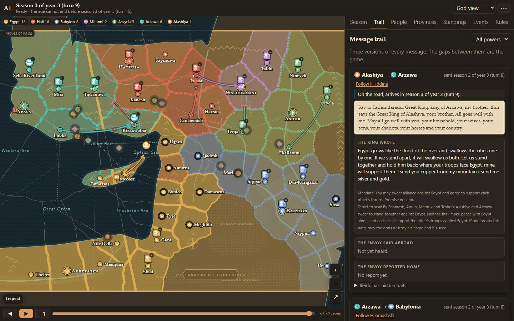
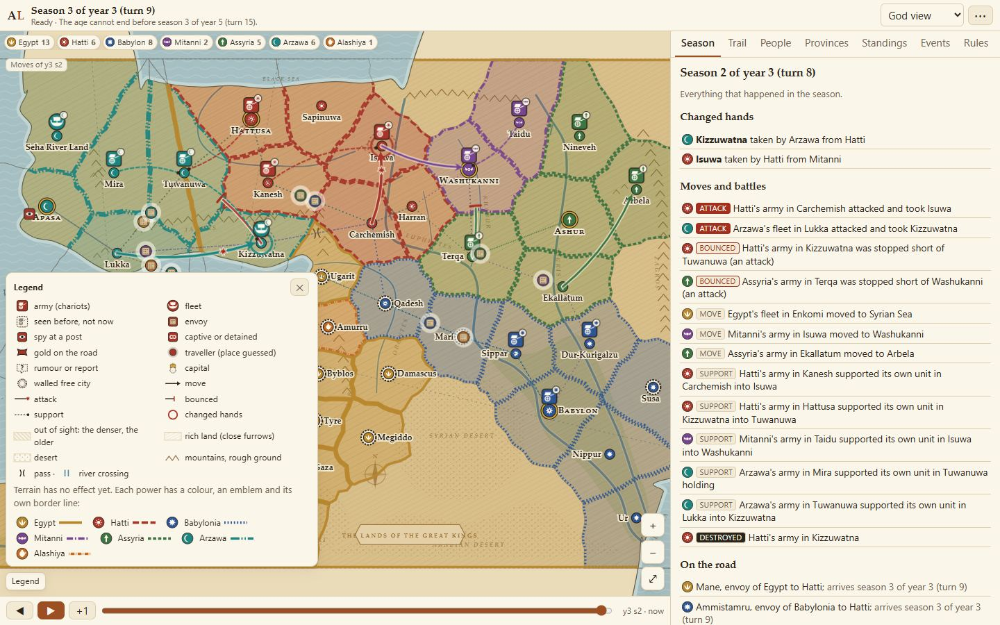
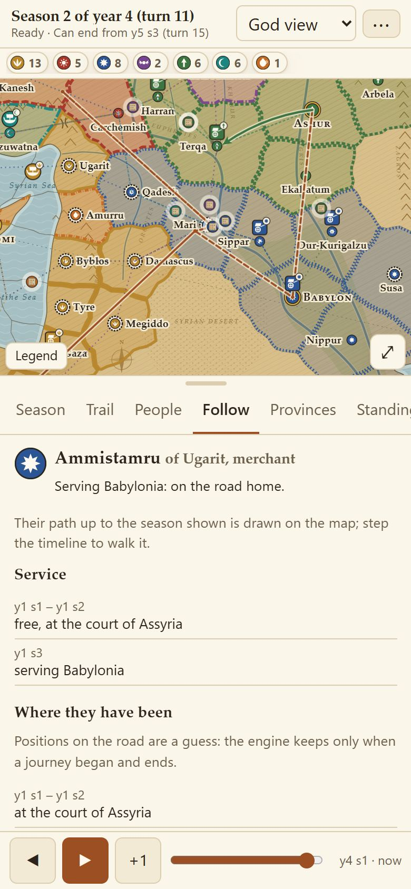

# Amarna Letters

A strategy game with no diplomacy rules, set among the seven Great Kings of the Late Bronze Age
(c. 1360–1330 BCE) and the city-states between them. The engine enforces physics: movement, combat, production and payment.
Every treaty, alliance and betrayal is invented by the players. Kings never speak to each other
directly: every word travels with an envoy who has motives of their own.

This is the prototype described in the design document *Amarna Letters — Prototype Design Document*.
Its job is to test one hypothesis: if communication is delayed, mediated by people with their own
motives, and impossible to verify fully, then norms of trust, reputation and enforcement emerge
on their own.

**Play it in your browser:** <https://haaktuah.github.io/amarna-letters/>

Play a king or a city yourself, watch Claude play them all, or mix the two. With no API key, every king
and envoy is a script player, and a whole game costs nothing.



*The message trail. Every message exists in three versions: what the king wrote, what the envoy
said at the foreign court, and what the envoy reported home. The gaps between them are the game.*

## How to play

You are one of forty-seven powers: the seven Great Kings, Egypt, Hatti, Babylonia, Mitanni, Assyria,
Arzawa and Alashiya, or one of the forty city-states and chiefs between them, Byblos, Amurru, Ugarit and
the rest, on one scoreboard: each power is judged by its size and by its growth against what powers that
started where it did have achieved, so a city that holds its own can win as well as an empire. Each season you read what reached your court, receive foreign envoys, and give your
orders in secret. Every king orders at the same time, and the engine resolves everything at once.
Three seasons make a year.

You see only what your kingdom can see: your own land, the provinces where your troops stand or
your spies watch, and one step beyond them. Everything else you know from letters, reports and
rumours, and those can be late, shaded or false.

### A season

1. **The land and its upkeep.** In its season the harvest is reaped and taxed into each province's stores; mines and
   markets bring in gold; people eat, and the hungry move. Troops are paid from your treasury and fed from your
   stores, works are kept as you ordered, and troops left unpaid or hungry for long mutiny.
2. **Arrivals.** Envoys, gold, spy reports and rumours that were on the road arrive.
3. **Audiences.** Foreign envoys deliver their message in their own words. The host answers, and
   may bribe the envoy, offer it a post, seal its tablet, detain it or send gold back. Each audience
   has up to two exchanges, and the envoy decides how to respond.
4. **Orders.** Every king submits secret, simultaneous orders.
5. **Resolution.** Movement and battles, then sieges. Land changes hands, and a kingdom whose
   capital is taken falls. Then come cessions and gifts, purchases, walls, levies, envoys setting
   out, hiring, intelligence and seeded catastrophes.
6. **Reports.** News of the season reaches each court the next season.

### What a king can do

**Armies and fleets.**
- Move, hold, support and convoy, as in Diplomacy, but each unit fights by its men, shaped by its commander, with
  its supports; ties bounce, and there are no dice. The loser loses men and falls back, and one beaten three to one,
  or with nowhere to go, is destroyed. You may support any power's unit, which is how alliances fight together.
- March at the pace of the road: a long road takes several seasons, a big army moves slower, and a forced march saves
  a third of the time at the cost of stragglers.
- Besiege a walled city your army stands in, or sally from your own walls (level 2 or more) against troops inside them.
- Give standing orders that answer a blow in the same season, while you sleep or play.
- Levy an army or a fleet from the men of a province of your homeland, or disband one, its men going home. A full army
  of 5,000 men costs 100 shekels to levy and 20 a season to keep, a fleet of 2,000 crews 120 and 25, and a smaller or
  larger unit costs in proportion. Troops need food as well as pay: a unit left hungry or unpaid for long mutinies.

**Land and gold.**
- Take a city by conquest, or as your vassal by a sealed tablet: no city is bought.
- Cede provinces, give troops, and send gold with an envoy.
- Debase the gold you send. The receiver's ledger counts it at face value until they pay
  10 shekels to assay the lot.
- Strengthen the walls of a city you hold, up to level 3, for 50 shekels times the new level.

**Envoys and letters.**
- Send up to three envoys a season, each with a letter of up to 1,500 characters, a mandate
  saying what it may agree to, gold, and tablets. An envoy takes one to three seasons each way,
  by distance.
- Every letter opens with the formula of the real Amarna letters ("Say to …, my brother: thus
  says the Great King …"). Who is called brother, and who is granted "Great King", shows how a
  court stands with you.

**Tablets.**
- Write a treaty on a tablet (20 shekels) for your envoy to offer for sealing.
- Send a copy of a sealed tablet to a third court as evidence.
- Have a tablet examined for forgery, or forge one yourself (40 shekels, with a servant skilled
  enough).
- Tablets are evidence only: nothing in the engine enforces them.

**Court and spies.**
- Hire from the open market, where people name their own price, and dismiss servants.
- Run background checks on what a person hides.
- Post spies at a foreign court or in a province, and pay watchmen against other kings' spies.
- Hold a caught spy for ransom or try to turn it, and pay the ransom for one of your own.
- Hear your royal council: four advisors (General, Steward, Tjaty and Diviner), each with a known tilt, who see only
  what you see and propose troop orders and levies. The omens darken as the end grows likelier, in your court's own voice.

**Command at a distance.**
- Your court is where you are, and you may move it. An order for a place your couriers cannot reach this season goes
  out now and is carried out when it arrives, and a courier on a foe's closed roads may be stopped.
- Grant command of an army, or a province as its governor: a grant of authority, not a job. What the man gets is what
  holding it gives him, and you take it back by sending word.

**The land and its people.**
- Each province's people farm, pay a tax you set (a third of the crop by default) into its stores, and eat what they
  keep. The harvest comes in its season; droughts, floods and low Niles cut it. People who go hungry flee, and loose men
  on the roads may raise bands of their own.
- Sell and buy grain and goods at your own markets, where prices follow supply; send caravans and trade abroad, and set
  tolls on your roads.
- Keep or raise your walls, roads, relay stations, harbours, police and water works, in gold or by corvée: nothing is
  kept unless you order it, and an army in another's land can raze them.
- Hunger, levies, a sack and troops taking food breed unrest. Your troops and a loyal governor lower it; a revolt where
  your troops do not stand may put a province under a ruler of its own, or leave it lawless.

**Tongues.** Every court speaks and reads its own languages. An envoy needs a tongue the host understands, a tablet
waits until someone at court can read it, and people learn the tongues of where they live.

### Walls, sieges and terrain

Walls stand where the sources put them. Hattusa, Washukanni, Ashur and Babylon have walls of level 3, as do
Qatna, Qadesh and Hazor; Apasa, Enkomi and the great fortresses (Carchemish, Aleppo, Ugarit, Arwad, Byblos, Tyre,
Shechem, Gaza, Nubia and Susa) have 2; most other towns have 1, and Pharaoh's new city of Akhetaten has none.

- **Storming.** Walls add nothing to a field battle. A move into a walled city takes it at once only
  if its strength also beats the walls plus the defenders.
- **Besieging.** Otherwise the army stands inside and can besiege. Each season it holds there wears
  the walls down a step, or two with a support. A besieged city yields nothing, and the siege costs
  the besieger 15 shekels a season.
- **Envoys under siege.** An envoy leaving a besieged capital may be caught, and a timid one will
  not go.
- **Terrain.** A unit standing its ground on rough ground, behind a mountain pass or a great
  river, or against a landing from the sea, gets +1. An army in desert land its king did not hold
  pays 30 shekels a season for supplies.

### Winning

A realm's strength is ten times the yield of the land it holds, plus its gold and what it holds besides, never
counting what it owes. Conquered land counts as it is absorbed, over its first seasons. Its growth is that strength
against its strength at the start. At the end each power's score blends two things: its performance, its growth
ranked among the results of powers that started where it did (most of the score, so a city that holds its own can
win as well as an empire), and its size, its strength against the largest living realm's (a small part, 5 percent by
default). The highest score wins.

Any season may be the last, from the first: early on it is very unlikely, and it grows likelier with every year, so
that half of all ages have ended by 1320 BCE (season 80). The engine draws the last season once, in secret, at the
start, with a hard cap drawn from 140 to 160 seasons; nothing shown reads it, and the omens darken only as the end grows
likelier. The median and the cap's range (or none) are table settings, and a table can play an open age with no end, from
the start or by playing on once the age has ended.

A kingdom falls with its capital, which passes to whoever took it. The rest of the realm comes apart as word of the
fall reaches each part: where the conqueror's troops stand the land is his, a governor of the fallen king's may rule
his province in his own name, as a new power, and the rest falls lawless; armies with a commander become his band, and
the others disband or follow a captain of their own. A fallen player watches the rest of the game in god view (a table
setting).

There is one winner. Shared victory for sworn allies is a house rule, off by default.

## The seven Great Kings

Every king reads every power's opening position. The script kings each play a temperament of their
own, varied a little in every game.

| Power | Capital | Tier | Starts with | How the script king plays |
|---|---|---|---|---|
| **Egypt** | Akhetaten | Strong | armies of 7,500 men in Memphis and Akhetaten, small garrisons in Gaza and Sumur, a fleet in the Nile Delta, 900 shekels | "Pharaoh of the gilded gifts": generous, proud and diplomatic; buys friends with gold "as plentiful as dust" |
| **Hatti** | Hattusa | Strong | armies of 7,500 men in Hattusa and Nesa, a fleet in Kizzuwatna, 300 shekels | "The conqueror of Anatolia": the most aggressive king, vengeful, little given to trade |
| **Babylonia** | Babylon | Strong | armies in Babylon, Sippar and Dur-Kurigalzu (10,000 men in all), 600 shekels | "Keeper of the old order": the proudest and greediest; cautious, and will not call Assyria brother unless they are friends |
| **Mitanni** | Washukanni | Middle | armies of 5,000 men in Washukanni and Taidu, 450 shekels | "Seeker of a patron": the most diplomatic and among the most honest; squeezed between Hatti and Assyria |
| **Assyria** | Ashur | Middle | armies in Ashur, Nineveh and Ekallate (4,000 men in all), 300 shekels | "The upstart who would be brother": aggressive and cunning, hungry to be counted a Great King |
| **Arzawa** | Apasa | Weak | an army of 10,000 men in Apasa, a fleet in Apasa's waters, 300 shekels | "The western opportunist": the most cunning and least honest |
| **Alashiya** | Enkomi | Weak | an army in Enkomi, a fleet in its waters, 400 shekels | "The copper merchant": the island trader, the most cautious and least aggressive |

Between the great kingdoms lie the city-states, such as Ugarit, Byblos, Qadesh and Elam, and the Kaska,
Lukka, Shasu and Sutean chiefs: forty powers of their own, most of them vassals of Egypt or Mitanni (a few of Hatti
or Arzawa) by sealed tablets, with the same rules and the same goal as the kings. Alashiya is an island, reached only by sea.

A script king sees only what its seat sees. It remembers who wronged it and who kept faith, and
checks its orders against what its rivals are likely to do by playing the season out with the
engine's own adjudicator. When one king runs away with the game, the others swear coalitions
against him and strike at his land together; a king attacked by a strong neighbour asks the
neighbour's other neighbours for a defence pact. Script kings give standing orders too. The god
view lists each king's temperament under **Standings**. Every rule they follow, with its numbers,
is in [docs/DESIGN-NOTES.md](docs/DESIGN-NOTES.md) under "Script kings".

## The courts

No court has missions, goals or rules of its own. Each plays differently because of what it has, what it
lacks and where it stands, and the same court plays differently from game to game as floods fail, roads
close and rivals change. The harvests, mines, markets, roads and tongues of the map carry this out: each court's
strengths and wants come from its land, not from a rule about it.

- **Egypt, the banker.** Rich in gold and grain, short of horses, timber and tin. Its game is spending
  well: buying allies, horses and cedar, and holding Canaan to keep the coast road.
- **Hatti, the soldier with an empty granary.** Horses and silver, rain-fed land that fails in drought,
  and enemies on every side. It needs wars that end quickly, and grain from Syria or Egypt.
- **Mitanni, the toll keeper in a vice.** Horses, and the Euphrates crossing that eastern tin takes going
  west, squeezed between Hatti and a rising Assyria. It collapsed in exactly these years, so its game is
  survival.
- **Babylonia, the distant merchant prince.** Grain, horses and the start of the eastern tin road, far
  from the fighting. Its game is prestige, recognition and marriages, and it can tighten the tin.
- **Assyria, the upstart.** Small, on the tin road, growing by squeezing Mitanni and fighting to be
  counted a Great King. Burna-Buriash of Babylon protested to Pharaoh at Assyrians being received as if
  they were independent (letter EA 9).
- **Arzawa, the western sea power.** River gold, and a coast where western tin lands; Hatti's rival from
  the other side.
- **Alashiya, the lottery winner.** Copper and timber of its own on its island. Its game is price and
  balance, and tin is its weak point.

**The Levant, the boiling pot.** Between the great kingdoms lies the board's centre: a crowd of vassal
cities where the spheres of Egypt, Mitanni and Hatti meet. Each ruler protests his loyalty to Pharaoh
while taking his neighbours' towns and denouncing them as traitors, and most of the surviving letters are
theirs. Rib-Hadda of Byblos wrote more than sixty, begging for troops and grain against Abdi-Ashirta of
Amurru and then his son Aziru, who played Egypt against Hatti and in the end went over to Hatti. It is
where the great kings' spheres meet, and where the truth is hardest to find.

## Envoys and other servants

More than a hundred people move between the courts: the envoys, officials and agents attested in the Amarna letters
(Mane, Keliya, Pirissi, Hani, Yanhamu and others) and the rest named in their region's style, each speaking the
tongues of where they have lived. A Great King starts with two envoys and a city-state with one; everyone else is
free, at the court of their region, looking for a master. A job is an errand carried to the man wherever he is:
what to do, where and by when, a part of the fee paid now and the rest on completion, each payment by your order.

Each has traits from 0 to 100 (loyalty, greed, competence, ambition, courage, and sympathy for a
court), secrets at three levels of secrecy, and a memory that travels with them to a new master.
Nobody shows you their traits. You learn them from what they do, from background checks, and from
what others tell you.

What an envoy can do to your words, and why:

- **Soften them.** A timid envoy, or one fond of the host, drops the threats aimed at the host.
- **Shade the report home.** A faithful one repeats the host word for word. A bribed one, or a
  timid one that is not faithful, leaves out the host's threats against you.
- **Sell them.** An envoy that took a host's gift carries home what the host asked it to say, and
  vouches for it.
- **Overreach.** An ambitious envoy may promise more than its mandate, then tell you it gave "such
  assurances as you would wish".
- **Skim.** A greedy, disloyal envoy keeps part of the gold it carries, and may forge a new inventory
  to hide it.
- **Change masters.** An envoy takes a host's offer of a post if it pays well enough and its
  loyalty is low, or if it already favours that court.
- **Be detained.** A host may hold your envoy, and with it your letters and gold.

No servant is paid unless you order it, by hand or by a standing order ("pay on delivery"). A servant left unpaid
remembers it, and so do those who hear of it. When an errand ends it ends: keeping the man is a new offer, which he
may refuse or price higher.

Spies watch a court or a province and send reports home. Watchmen catch them, and a caught spy can
be ransomed, or turned into a double agent who sends home poisoned reports.

Envoys are script characters in the Free and Local agents presets and Claude Haiku in the others; Customize can give
them Sonnet.

## Playing with Claude

Pick a preset, choose whether to watch or take a seat, and begin.

| Preset | Kings | Envoys and spies | Narrator | Rough cost of a game |
|---|---|---|---|---|
| **Free** | Script kings | Script | Template | $0, no key needed |
| **Budget** | Haiku 5.5 | Haiku 5.5 | Haiku 5.5 | about $2 |
| **Counsel** | Haiku 5.5, with Sonnet 5.5 writing each king's plan once a year and taking what is passed up | Haiku 5.5 | Sonnet 5.5 | about $25 |
| **Standard** (recommended) | Sonnet 5.5 | Haiku 5.5 | Sonnet 5.5 | about $30 |
| **Showcase** | Opus 5.5 | Haiku 5.5 | Opus 5.5 | about $60 |
| **Local agents** (this computer only) | Claude Code agents | Script | Template | your Claude subscription, no key |

The costs are the start page's estimates, reckoned for a game of 44 seasons; an age of the usual length (about 80
seasons) costs nearly twice as much. The meter in the game shows the real spend.

Envoys stay on Haiku even in Showcase: they make the most calls, and the design wants fallible
messengers. **Customize the table** sets each king separately (script, human, Haiku, Sonnet or
Opus, for model-against-model experiments, and a local agent when the app runs on your computer),
Sonnet envoys, the narrator, thinking effort and the house rules. The estimates are rough; the
meter in the game shows the real spend, and the game pauses at a spending cap set from the
estimate (you can change it).

Model seats use your own Anthropic API key: calls go straight from the page to the Anthropic
API, and the key is never stored outside this tab. Use a dedicated key with a spend limit set in
the Anthropic Console. **Simulate the API** (under Customize) tries model seats with canned
replies; nothing leaves the browser. When a model call fails, a script king or character makes
that decision instead, the failure is listed at the top of the side panel, and the game goes on.

**Local agents** is local play, for your own games: you take a seat, and the other kings are guarded Claude Code agents
answered in a Claude Code session on your Claude subscription, through a small bridge on this computer
(`node sim/bridge.js`). It appears only when the app runs on your computer. The steps are under "Local play" in
`sim/README.md`, and the session's start prompt is `docs/PLAY-PROMPT.md`.

### Sleeping seats

Long games become affordable when model calls scale with events, not with time. **Sleeping
seats** are on by default: after giving its orders, a model king sleeps, and it never chooses when
it wakes. The world goes on, its units hold and its scheduled orders run, each following its unit
(a march stopped by a bounce tries the step again, and a new levy can be given orders ahead), and
its standing orders answer, in the same season, a unit it sees setting out to enter a province or
to attack one of its own. It is woken only when something concerns it: an envoy at the door,
foreign troops in its land or arriving next to its homeland or a walled city it holds, land or
troops lost, a failed scheduled or standing order, a servant giving notice, or a ransom demanded.
Everything else waits in a digest, and a hidden safety cap wakes it after a long sleep. Script and
human kings play every season. Switch it off (Customize in the web app, `--sleep off` in the batch
runner) to ask every king every season. Standing orders are every king's, awake or asleep: script
kings give them, and a human gives them in the orders panel. The details are in `docs/DESIGN-NOTES.md`.

## Watching a game



In games without a human, the god view shows everything the engine knows: true map, every
treasury, every character's hidden traits and facts and who knows them, and the **message
trail**: for every message, what the king wrote, what the envoy said abroad, and what the envoy
reported home. Switch to any power to see exactly what it saw. The side panel's tabs show the
season's events, the trail, the people, the provinces, the standings and the rules. The timeline
steps back through the seasons; signals mark sealed tablets, accusations, forgeries, broken
promises and more. After the game, compare two nations' self-serving annals with the true record.

The map is a museum map of the Late Bronze Age: coasts, rivers, mountains, deserts and fields,
each power in its colour with an emblem and a border line of its own (so it reads without
colour), armies as chariots and fleets as ships. Step the timeline and each season's moves,
attacks, supports, bounces and captures are drawn; envoys, spies and gold appear on the road
and at foreign courts. In a power's view the fog of war fades with the age of its sight, and
uncertain things (old sightings, rumours, spy reports) are drawn as such. Tap anyone to follow
their life: their path, their masters, their missions, what they said and reported.

The map lives with the year: the Nile's flood in Akhet, green fields and snow on the heights in Peret, the harvest's
gold in Shemu, rivers in spate and storms on the open sea. Droughts and floods show where your court last saw them, a
battlefield keeps its stele, and a sacked city lies in ruins until its people come back. Each court's map is pressed in
clay, and Egypt's is drawn on papyrus.

**Legends** tells the game's stories from the record: each character's life, each tablet's history, the rise and fall
of courts. When the age ends, every seat may open the whole record in god view.

On a computer, Space pauses and unpauses, 1 to 5 set the speed (1 the slowest), and + and − make it faster or
slower, as in Crusader Kings III; no key acts while you type. Each button's tooltip names its key.

A link to `play?watch=7` (any seed) starts a game of script kings to watch. Games are saved in the
browser, and a game's log can be exported and loaded again to replay it exactly.

## On a phone



It is built phone first: the map fits the screen with pinch-zoom, the panels open from it, and
the app installs to the home screen and starts from cache.

## Your first live game: a checklist

1. Create a dedicated API key with a low spend limit (a few dollars) in the Anthropic Console.
2. Start with a mixed table: Sonnet 5.5 leaders, script characters, template narrator. Set the
   budget to $3.
3. Watch the cost meter in the game's header for the first two seasons; the per-season figure tells you
   what a full game will cost.
4. Open the **Message trail** tab once envoys start arriving: the gap between what was written,
   said and reported is the thing to look at.
5. If calls fail, the top of the side panel lists them; each failed call falls back to a script
   decision and the game continues. Export the log (the ⋯ menu) to keep the prompts and outputs.

## For developers

### Run locally

You need Node 22 or later.

```bash
npm ci
npm run dev --workspace src/web
```

Then open <http://localhost:5183>, pick a preset, choose whether to watch or take a seat, and begin.

### Tests and the batch runner

```bash
scripts/cloud-setup.sh   # on a fresh cloud machine: the npm packages and Playwright's Chromium, if missing
scripts/test.sh          # type-check, the engine's determinism lint, and every test (Vitest), printing only the
                         # summary and the failures (the full log goes to $TMPDIR/amarna-test.log)
npm run build --workspace src/web && node src/web/smoke.mjs   # the Playwright smoke test of the built app
```

```bash
scripts/sim.sh --games 50 --seed 1 --verify-replay
```

The batch runner plays games unattended and prints wins by power and the success signals.
With `ANTHROPIC_API_KEY` set it can run model games too (`--preset budget`, `counsel`, `standard` or `showcase`, or per role:
`--leaders sonnet --characters haiku --narrator sonnet`), stopping at `--budget` dollars; every
such game costs real money. `--no-primer` runs the
customs-primer experiment; `--out logs` keeps every game's log. `--versus solo` measures the
script king against the frozen first version (one king at a time, against six of the old), and
`--versus baseline` and `--focus <Power>` mix the two. Script games run on every core.
`--sleeping-scripts` lets script kings sleep as model kings do; they then schedule conditional orders ahead, which
`--no-plan-ahead` turns off and `--plan-ahead-half` gives to half of them, to measure what it is worth.
The measure of call size (item 6b) shadows script games with model kings and splits their requests into parts:
`node --experimental-strip-types --no-warnings src/batch/src/measure.ts --games 20 --seed 1` (`--per-audience` for
one call per audience, `--dump DIR` for sample requests). It calls no model.
`--sleep off` turns off sleeping seats, `--sleep-cap N` sets
the hidden safety cap on a sleep, `--max-turns N` stops a game after season N at the latest (a known cap), `--cap 140-160` or `--cap none` sets
the hard cap's range, and `--median N` the season by which half of all ages have ended (80 by default).
`--file-seats DIR` makes every king a file seat:
it writes what a model king would see to its own folder and waits for a JSON reply file, which is
how `sim/` plays a game with Claude Code agents as the kings (see `sim/README.md`).

### Publishing and CI

Changes go in through pull requests: every pull request builds and runs the tests
(`.github/workflows/pages.yml`) and gets a playable preview at its own address,
`https://haaktuah.github.io/amarna-letters/pr-<number>/`, linked in a comment on the pull request and removed when it
closes (`.github/workflows/preview.yml`). Merging into `main` publishes the browser game at the site's root. Both are
written to the `gh-pages` branch, which Pages serves: `main` to its root, each pull request to its own `pr-<number>/`
folder (`scripts/site-prepare.sh`, `scripts/site-publish.sh`). No pull request's own code can write to that branch, so
none can replace the root. To publish the static files somewhere else, such as S3:

```bash
npm run build --workspace src/web
```

The site is `src/web/dist`. If it is served from a sub-path, set `<base href>` in its
`index.html` to that path.

### How it is put together

Every game is deterministic: the same seed and the same decisions give the same game, and every
log replays exactly.

| Package | What it is |
|---|---|
| `src/engine` | The deterministic engine: map, state, orders, validator, adjudicator, economy, envoys, tablets, spies, catastrophes, scoring. Pure TypeScript, no I/O; a lint config keeps out clocks, unseeded randomness, culture-sensitive text and inexact `Math`. |
| `src/game` | Seats, character minds and the narrator as interfaces; the runner that records every decision; script kings (temperaments, memory, a look-ahead over likely rival orders) and script characters; signal detection. |
| `src/llm` | Claude leaders (Sonnet 5.5 / Opus 5.5), characters (Haiku 5.5) and narrator (Sonnet 5.5): prompts, JSON schemas, parsing, cost accounting, the API simulator, file seats and the local bridge. Calls are posted with `fetch`, in the browser and the batch runner alike. |
| `src/web` | Vite and React app: setup, SVG map, human orders and audiences, spectator views, timeline, chronicles, IndexedDB saves. The engine, the script kings and characters run in a Web Worker; the page only shows what it sends. |
| `src/batch` | Node runner for unattended games, on worker threads. |
| `src/*/test` | The tests (Vitest), ported from the C# suite: engine, script kings and characters, model layer against a simulated API, and the web map's scenes. |
| `tests/fixtures` | Recorded model games (JSON lines), kept as data. The C# build the game was converted from (build order item 5+) was removed after the fix pass; it is in `develop`'s history at commit `5b4caa2`. |

### Design notes

[docs/DESIGN-NOTES.md](docs/DESIGN-NOTES.md) records every decision and simplification made while
building, and every rule as implemented. [docs/BUILD-PROGRESS.md](docs/BUILD-PROGRESS.md) tracks the
build order item by item, with each item's report in `docs/rounds/`.

## Credits

The game was inspired by Irving Finkel's *Curator's Corner* episode 100, "Reading the Pharaoh's
private mail with Irving Finkel" (The British Museum,
<https://www.youtube.com/watch?v=3MZq_ZQDhJA>), and leans on William L. Moran's *The Amarna
Letters* for the translations of the letters themselves.
