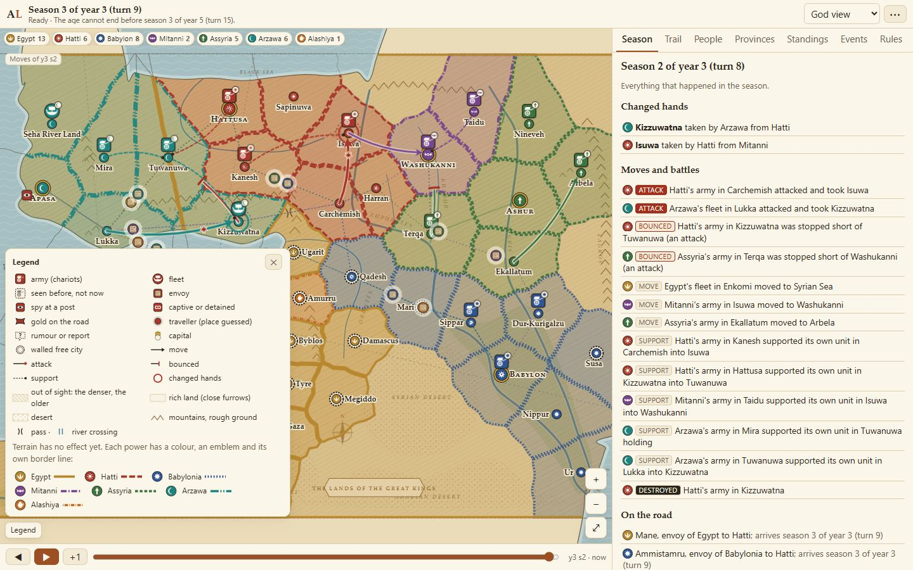
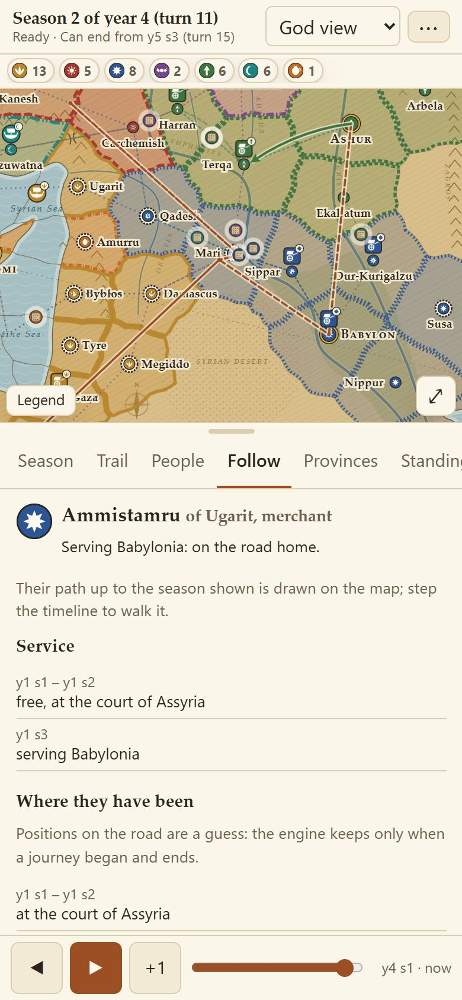

# Watching a game

The god view, the map, the keys, saving, and the phone.

In games without a human, the god view shows everything the engine knows: true map, every
treasury, every character's hidden traits and facts and who knows them, and the **message
trail**: for every message, what the king wrote, what the envoy said abroad, and what the envoy
reported home. Switch to any power to see exactly what it saw; a king played by a model has an **Own words**
tab with his notes, summary, plan and ledger as they stood at the season shown. The side panel's tabs show the
season's events, the trail, the people, the provinces, the standings and the rules; with a mouse,
the tabs and the courts along the map scroll with the wheel or by dragging. The timeline
steps back through the seasons; signals mark sealed tablets, accusations, forgeries, broken
promises and more. After the game, compare two nations' self-serving annals with the true record.

The **Threads** tab, open wherever the whole record is (a game without a human, or once the age ends), lists the few
live stories with the most at stake this season, as the narrator picks them: a city a season from falling, an envoy
on his road with gold or a tablet (and, in god view, whose pay he is really in), a people ready to rise behind a man.
Each is a click away: follow the person, open his message trail (god view), or show the place on the map. Through a
power's eyes it lists only what that court knows. Tick **Director camera** and the map goes, as each season plays out,
to the scene with the most at stake; it is off by default. The narrator's words are kept in the saved game the first
time, so watching it again reads them back; **Tell anew** has the narrator tell them again, keeping the first telling
beside the new, as the Chronicles tab does for the annals. A king played by a human sees no threads during play.

The map is a museum map of the Late Bronze Age: coasts, rivers, mountains, deserts and fields, each power in its
colour with an emblem and a border line of its own (so it reads without colour), armies as chariots and fleets as
ships. Every city is a seal; tap it to open its province. Step the timeline and each season's moves, attacks, supports
and captures are drawn, and envoys, spies and gold appear on the road and at foreign courts. Each realm shows in three
steps of its colour: full where its king rules, lighter where a governor stands between, a faint wash over its vassals'
land. The ◐ button shows the mood of the land as you last heard it. Tap anyone to follow their life: their path, their
masters, their missions, what they said and reported. Zoomed in, the colours thin so the ground and the figures show
through.

The map lives with the year: the Nile's flood in Akhet, green fields and snow on the heights in Peret, the harvest's
gold in Shemu, rivers in spate and storms at sea. The snow creeps down and melts, the Nile rises from the south and the other rivers in spate from their sources, the
green spreads inland with the rains. A battlefield keeps its stele, and a sacked city lies in ruins until its people
come back. Each court's map is pressed in clay, and Egypt's is drawn on papyrus.

**Your map is what your court knows.** In a power's view the fog fades with the age of its sight, and anything far
from your court (a city sacked, a province lost, your own troops and stores there, the mood of a land) stands as you
last heard of it, dated, until word comes by the road. Your vassals and allies send you word of land they see change
hands, sometimes before your own. To know sooner, hire a rider at your court to fetch one far province's report this
season. Looking back at an earlier season shows what you knew then, never today's figures.

**Legends** tells the game's stories from the record: each character's life, each tablet's history, the rise and fall
of courts. When the age ends, every seat may open the whole record in god view.

Each season plays out on the map: the envoys arrive, the columns march, then the battles, the sieges and the cities
that fall, and a short line closes the season with what changed. Armies march as columns along their roads, fleets
heel under sail, a battle flares with the winner's seal, a siege's tents close round its city. Only what your court
knows plays: a disaster far away is only a line of news.

On a computer every action has a key (Space pauses, 1 to 4 set the pace, Enter seals your orders, F1 to F10 open the
panels); each button's tooltip names its key, and the **Keys** page lists them all and lets you change them. The pace
sets only how long each season is watched, from Slow (about 15 seconds) to Simulate, which draws nothing and opens the
game at its last season. Your own season always waits for your orders.

Games are saved in the browser, and a game's log can be exported ("Export log" in the menu) and loaded again to replay
it exactly. The export can leave out the human players' words and the names they made up, so it can be shared; keys,
addresses and account details are never recorded at all.

## On a phone

It is built phone first: the map fits the screen with pinch-zoom, the panels open from it, and
the app installs to the home screen and starts from cache.

